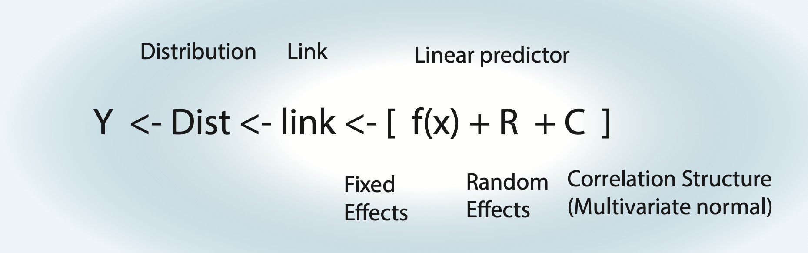

```{r, include=FALSE}
set.seed(42)
```

# From question to paper: the analysis workflow {#sec-summary}

This chapter brings together what we have learned in this book as a workflow for analyzing your own data, from the scientific question to the methods and results sections of a paper. The seven steps are the same as in the overview in the Preface. Each step links to the sections where the respective topic is explained and to the lookup tables in the quick reference. If you have a concrete problem with your analysis, the table in the quick reference (@sec-cheat-lookup) points you to the relevant section. The tables and decision rules in this chapter and in the quick reference (@sec-cheat) guide you, but they do not replace judgment about your data.

## The workflow at a glance {#sec-summary-overview}

1.  **Question and goal.** Is your goal to estimate a causal effect, to predict, or to explore? The answer determines which variables you include and whether model selection is appropriate (@sec-causal, @sec-select).
2.  **Design and data.** What is the replicate (experimental unit), and how are the observations grouped (sites, plots, individuals, years)? Get an overview of the missing values (@sec-miss) and of the data: range of the response (bounds, many zeros: @sec-glm-zero-inflation), range of and correlations between the predictors (@sec-lm-collinearity). If you are still planning the study, see the section on power and sample size (@sec-summary-design).
3.  **A-priori model.** Choose the distribution from the type of response (@tbl-cheat-family), the predictors from the question (for causal questions with a causal diagram, @sec-causal-framework), and the random effects and correlation structures from the design (@tbl-cheat-design). Center and scale numeric predictors if needed (@sec-lm-centering-scaling). Specify this model *before* you look at the results.
4.  **Fit the model** (@sec-summary-check).
5.  **Check the residuals and adjust the model** (@sec-summary-check, @tbl-cheat-residual). Change the model to remove misfit, not to obtain significance (@sec-select-phacking).
6.  **Inference:** tests, confidence intervals, predictions (@sec-summary-inference).
7.  **Report** the analysis so that others can understand and reproduce it (@sec-summary-report).

## From question to model {#sec-summary-strategy}

::: {#reminder-modelling-strategy}
:::

All models in this book are special cases of the general model shown in @fig-summary-model: a linear predictor (fixed effects, possibly with splines or nonlinear functions, plus random effects), a link function, a distribution and, if needed, a correlation structure. Building the a-priori model means choosing each of these components, and each of them follows from a different aspect of your study.

{#fig-summary-model fig-alt="Schematic of the general model: Y is drawn from a distribution (Dist), whose mean is connected by a link function to a linear predictor f(x) + R + C, consisting of fixed effects, random effects and a correlation structure (multivariate normal)."}

**The distribution follows from the type of response:** continuous, counts, binary, k out of n, proportions or categories. The table of model families in the quick reference (@tbl-cheat-family) lists the options with examples and R code. Choose the family from the type and range of the response (e.g. counts are integers ≥ 0), not from the shape of its histogram: the distributional assumptions refer to the residuals, which you check after fitting (step 5).

**The predictors follow from the goal of the analysis:**

-   For a **causal** question, write down a causal diagram, adjust for confounders, but not for colliders, and for mediators only if you want the direct effect (@sec-causal-framework). Only the effect of interest can be interpreted causally (@sec-causal-table2).
-   For **prediction**, the goal is the model with the best out-of-sample performance, e.g. via AIC, cross-validation or shrinkage (@sec-select-methods, @sec-select-cv, @sec-select-shrinkage).
-   An **exploratory** analysis can generate hypotheses, but its p-values are not valid tests of these hypotheses (@sec-select-pvalue).

**The random effects and correlation structures follow from the design:** repeated observations of the same sites, plots or individuals call for random effects; observations over time, in space or of related species possibly for a correlation structure; unequal sampling effort for an offset. The quick reference translates typical designs into model components (@tbl-cheat-design); for how to derive the random effects from the study design, see @tip-re-design.

## Fitting and checking the model {#sec-summary-check}

Most models in this book can be fitted with `lm()` and `glm()` (base R), `lme4::lmer()` and `lme4::glmer()`, or `glmmTMB()`, which additionally fits dispersion models, zero-inflation and correlation structures. For linear models, `nlme::gls()` (and `nlme::lme()` with random effects) fits variance and correlation structures, and `mgcv::gam()` fits GAMs. For when to use which package, see @sec-re-package; for the syntax, see the quick reference (@sec-cheat). A Bayesian alternative for all of these models is `brms` (@sec-summary-next).

Check the fitted model with residual plots, for GLMs and mixed models with the simulated residuals of DHARMa (@sec-lm-residual-dharma, @sec-glm-dharma), and adjust the model if you find a problem. The quick reference lists typical patterns, their likely causes and what to do about them (@tbl-cheat-residual). Work through the problems in a fixed order: first the functional form (do the predictors have the right shape?), then the distribution (dispersion, zero-inflation, changing variance), and correlation structures last. The reason is that a problem at an earlier step can create apparent problems at later ones: a missing quadratic term, for example, can look like overdispersion or temporal autocorrelation.

For mixed models, DHARMa simulates the residuals conditional on the fitted random effects by default. This is fine for the routine checks, but it can hide patterns at the level of the groups, e.g. spatial or temporal autocorrelation between sites. To check for these, re-simulate the random effects with `simulateResiduals(..., simulateREs = "unconditional")` (@tip-re-predtype; for models with a fitted correlation structure, see the subsection on conditional residual checks in @sec-corr-temporal).

## Inference {#sec-summary-inference}

Once the model is final, you can test hypotheses and calculate confidence intervals. Which tests and intervals are available depends on the model type: t- and F-tests for linear models, z- and likelihood-ratio tests for GLMs. For mixed models, the degrees of freedom are not well defined, so all tests are approximate or simulated, and which one to use depends on the model and the number of groups. The quick reference lists the options per model type (@tbl-cheat-tests); the recommendations for mixed models are in @tbl-re-inference and @tbl-glm-glmmtest. Comparisons between groups are calculated with `emmeans` (@sec-lm-posthoc, @nte-anova-emmeans).

Three points apply to all models:

-   p-values and confidence intervals are only valid for hypotheses that were specified before looking at the data. After model selection, they are too optimistic (@sec-select-pvalue).
-   Do not simply report the coefficient of the regression table: it answers one specific question (difference to the reference level; effect at one value of the other predictors; for GLMs, on the link scale). Decide which comparison, which values, or which average you want to report (@sec-lm-nonlinear-effect), and for nonlinear link functions, report effects on an interpretable scale: rate or odds ratios, means on the response scale, or the data-averaged effect (@sec-glm-effects, @tbl-summary-link).
-   For mixed models, decide whether you want conditional, unconditional or marginal predictions (@tip-re-predterms).

## Reporting {#sec-summary-report}

The methods section should allow others to reproduce your analysis:

-   the question, and whether the analysis was planned in advance or exploratory;
-   the response, the distribution and link, and the model formula, including the reasons for the random effects;
-   the handling of missing values, transformations, centering and scaling;
-   which residual checks you did (e.g. DHARMa simulated residuals: uniformity, dispersion, zero-inflation), and how you adjusted the model;
-   how model selection was done, if any;
-   how p-values and confidence intervals were calculated (test type, e.g. Wald or likelihood ratio test, and CI method, e.g. profile or bootstrap; for mixed models also the estimation method, ML or REML);
-   the software and package versions (and citations, e.g. `citation("glmmTMB")`).

Closely related is the reproducibility of your analysis, which reviewers and journals increasingly expect:

-   Do the entire analysis in a script (or a Quarto / R Markdown document), from reading the raw data to the final figures, not in the console. Never change the raw data by hand; do all corrections in the script. Use relative paths (e.g. with an RStudio project), so that the script also runs on another computer.
-   Set a seed (`set.seed()`) at the top of the script and before each step that uses random numbers (simulations, bootstrap, simulated LRTs, cross-validation, imputation), so that you and others get the same results. DHARMa fixes its own seed by default (argument `seed` of `simulateResiduals()`), so its residuals are reproducible anyway.
-   Record the R and package versions with `sessionInfo()` (results can change between versions, even for the same seed). To reproduce them later, use the `renv` package (`renv::init()`, `renv::snapshot()` to write the versions to `renv.lock`, `renv::restore()` to reinstall them).
-   Deposit the data (with a short description of all columns), the code and the `renv.lock` file together with the paper, e.g. on Zenodo or Dryad, and cite the DOI in a data and code availability statement.

The results section should report effect sizes with confidence intervals, on an interpretable scale, together with the number of observations and groups, and, where appropriate, effect plots with confidence intervals (@sec-lm-visualization). For GLMs, the coefficients are on the scale of the link function, so they should be translated (@tbl-summary-link):

| Link | Meaning of a coefficient $\beta$ | What to report |
|----|----|----|
| identity (`lm`, normal) | change of y per unit of x | $\beta$ with CI, in units of y |
| log (Poisson, negative binomial, Gamma) | y is multiplied by $e^\beta$ per unit of x | rate ratio $e^\beta$ with CI, or the percent change $(e^\beta - 1) \cdot 100$ |
| logit (binomial) | the odds are multiplied by $e^\beta$ per unit of x | odds ratio $e^\beta$ with CI |
| any link | predictions and effects on the scale of the response | predicted means with CIs at chosen values, e.g. `emmeans(fit, ~ x, type = "response")`, or the data-averaged effect (also called average marginal effect, AME; @sec-glm-effects); for mixed models, say whether these are unconditional (random effects at zero) or marginal predictions (@tip-re-predterms) |

: How to report coefficients for different link functions. {#tbl-summary-link}

For example, for the number of warp breaks in a weaving experiment (negative binomial GLM), the effects as rate ratios with CIs and the predicted means per tension level are:

```{r, message=FALSE}
library(MASS)
library(emmeans)
fit = glm.nb(breaks ~ tension + wool, data = warpbreaks)
exp(cbind(estimate = coef(fit), confint(fit))) # rate ratios with 95% CI
emmeans(fit, ~ tension, type = "response")     # means on the response scale
```

A results sentence could then read: "Compared to low tension, the number of breaks was 26% lower at medium tension (rate ratio 0.74, 95% CI 0.58-0.94) and 40% lower at high tension (0.60, 0.47-0.76; negative binomial GLM, n = 54, wool type held constant, profile-likelihood CIs)." For a mixed model, also state the number of observations and groups per random effect and the estimated random effect standard deviations (`VarCorr()`), e.g. "480 observations from 24 sites; standard deviation between sites 0.4 on the log scale". For a numeric predictor, calculate predictions with `predict(..., se.fit = TRUE)` on the link scale, add ± 1.96 standard errors, back-transform with the inverse link (e.g. `exp()` for the log link), and plot them together with the data (@sec-lm-prediction; for mixed models, @sec-re-prediction). An example of a methods and results text for an ANOVA is in @sec-anova-recommend.

::: callout-caution
#### Common mistakes in reporting

-   reporting p-values without effect sizes and confidence intervals;
-   reading a non-significant result as "no effect" (look at the confidence interval instead);
-   concluding that an effect differs between groups because it is significant in one group but not in the other, instead of testing the difference (@nte-anova-emmeans);
-   interpreting GLM coefficients as if they were on the response scale;
-   reporting a model found by model selection as if it had been planned in advance (@sec-select-pvalue);
-   using causal language for a predictive or exploratory analysis (@sec-causal).
:::

## Checking your analysis by simulation {#sec-summary-pipeline}

::: {#thoughts-about-the-analysis-pipeline}
:::

The workflow in this chapter (@sec-summary-overview) is a procedure: a model, residual checks, perhaps a model change, and finally tests and confidence intervals. Whether this procedure is good, i.e. whether its estimates are unbiased, its p-values calibrated and its confidence intervals correct, is often not known for a specific design, and textbook formulas only cover simple cases. The general way to find out is simulation: create data where you know the truth, run your analysis on them, and repeat this many times. Before you collect data, the same simulation also tells you how many observations you need (step 2 of the workflow).

For a simple linear regression, the following function creates data with a known slope (`effect`), fits the planned model and returns the estimate, its 95% CI and the p-value:

```{r}
simulateAnalysis = function(n = 100, effect = 0.5){
  x = runif(n)
  y = effect * x + rnorm(n)          # data with known truth, residual SD = 1
  fit = lm(y ~ x)                    # the planned analysis
  ci = confint(fit)["x", ]
  c(estimate = coef(fit)[["x"]], lower = ci[[1]], upper = ci[[2]],
    p = summary(fit)$coefficients["x", 4])
}
```

**Are the estimates and CIs correct?** We run the analysis 1000 times with a true slope of 0.5:

```{r}
set.seed(123)
out = t(replicate(1000, simulateAnalysis(effect = 0.5)))

hist(out[, "estimate"], breaks = 50, main = "", xlab = "Estimated slope")
abline(v = 0.5, col = "red")

mean(out[, "estimate"]) - 0.5                         # bias
sd(out[, "estimate"])                                 # true standard error
mean(out[, "lower"] < 0.5 & out[, "upper"] > 0.5)    # CI coverage
```

The bias is practically zero (-0.006): each single estimate has an error, but the errors average out. The standard deviation of the estimates (0.34) is the true standard error of the estimator; the standard error printed by `summary()` is an estimate of it, and the CI coverage (0.953, i.e. about 95% of the CIs contain the true value) checks that this estimate is right.

**Are the p-values calibrated?** We simulate without an effect (H~0~ true):

```{r}
set.seed(123)
outH0 = t(replicate(1000, simulateAnalysis(effect = 0)))
hist(outH0[, "p"], breaks = 20, main = "", xlab = "p-value")   # should be flat
mean(outH0[, "p"] < 0.05)                                     # type I error rate
```

If the model assumptions hold, the p-values under H~0~ are uniformly distributed, and about 5% of them are below 0.05. Note that the simulated rates are themselves estimates: with $B$ replicates, a rate $p$ has a simulation error of about $\sqrt{p(1-p)/B}$, i.e. ±0.007 for a rate near 0.05 with 1000 replicates. The 0.047 we get is therefore compatible with 0.05. Use more replicates if you need to tell close values apart.

To check your own analysis, replace the data-generating step and the model in `simulateAnalysis()` with your design. You can also include the steps you take after fitting, as long as they can be written as a rule, e.g. a refit with a negative binomial if the DHARMa dispersion test is significant, or AIC selection among a fixed set of models. Then simulate under H~0~ (if the procedure switches models, also with data that do and do not need the switch), and check the type I error and the CI coverage of the final estimates; they are often worse than for a single planned model. Worked examples of such an inflation are the model selection in @sec-select-pvalue and the heteroskedasticity example in @sec-disp-lm. Decisions made by eye cannot be simulated, which is one more reason to fix the analysis before looking at the data. For questions like these, simulation beats both textbook recommendations and closed-form power formulas.

### Power and sample size {#sec-summary-design}

::: {#experimental-design-and-power-analysis}
:::

When you plan a study, first decide the design: what the goal is (@sec-causal), what to randomize, hold constant or measure, and how observations are grouped (@tip-re-design). Then fix the analysis (variables and model), so that the simulation uses the model you will actually fit, and ask how many observations you need. The same simulation answers this: if we simulate with an effect, the share of p-values below 0.05 is the **power**, the probability of detecting this effect:

```{r}
set.seed(123)
mean(replicate(1000, simulateAnalysis(n = 50, effect = 1)[["p"]]) < 0.05)
```

With 50 observations, an effect of 1 is detected in about half of the studies (0.50). To find the sample size for, say, 80% power, we loop over n:

```{r}
set.seed(123)
ns = c(25, 50, 100, 150, 200)
power = sapply(ns, function(n)
  mean(replicate(500, simulateAnalysis(n, effect = 1)[["p"]]) < 0.05))
plot(ns, power, type = "b", xlab = "Sample size", ylab = "Power")
abline(h = 0.8, lty = 2)
```

We need roughly 100 observations (power 0.82 at n = 100). An effect size only means something relative to the noise: a slope of 1 is easy to detect if the residual SD is small and hard if it is large. Assume the smallest effect that would be biologically relevant (or a plausible value from the literature), and take the residual variation from a pilot study or from similar published data. Do not use the effect observed in your own data: power calculated from an observed effect is a function of the p-value and therefore uninformative.

::: {.callout-tip collapse="true"}
#### Power analysis for grouped count data

For a GLMM, the data-generating step follows the model: first draw the group effects, then the observations within the groups, all on the scale of the link function. Here, counts in plots within sites, with both treatments in each site, a treatment effect of 50% more individuals (`log(1.5)` on the log scale), a site SD of 0.5 and overdispersion (negative binomial with `theta = 2`):

```{r, warning=FALSE}
library(glmmTMB)
simulateCounts = function(nSites = 15, nPlots = 6, effect = log(1.5),
                          siteSD = 0.5, theta = 2){
  dat = data.frame(site = factor(rep(1:nSites, each = nPlots)),
                   treatment = rep(c(0, 1), length.out = nSites * nPlots))
  siteEffect = rnorm(nSites, sd = siteSD)                       # group effects first
  mu = exp(1 + effect * dat$treatment + siteEffect[dat$site])   # log link
  dat$count = rnbinom(nrow(dat), mu = mu, size = theta)
  fit = tryCatch(glmmTMB(count ~ treatment + (1 | site),
                         family = nbinom2, data = dat),
                 error = function(e) NULL)
  if (is.null(fit)) return(NA)                                  # failed fit
  summary(fit)$coefficients$cond["treatment", 4]
}

set.seed(123)
sites = c(5, 10, 20, 40)
powerGLMM = sapply(sites, function(s)
  mean(replicate(100, simulateCounts(nSites = s)) < 0.05, na.rm = TRUE))
plot(sites, powerGLMM, type = "b", xlab = "Number of sites (6 plots each)",
     ylab = "Power")
```

With 6 plots per site, 20 sites give a power of 0.66 and 40 sites 0.90, so roughly 30 sites are needed for 80% power. Some practical points:

-   Take the variance parameters (here `siteSD` and `theta`) from a pilot study or from published data, and try several values to see how sensitive the power is.
-   Vary the number of groups and the number of observations per group separately (in the example, the treatment varies within sites). For predictors that vary only between groups, the number of groups limits the power; for predictors that vary within groups (as the treatment here), more observations per group also help.
-   Fitting a GLMM takes time: use about 100 replicates while you develop the code and more for the final result. Count fits that fail or are singular, and report how many there were.
:::

For mixed models, you can also simulate from a model fitted to pilot data with `simulate()`, instead of writing the data-generating step by hand, and the simr package [@green2016simr] automates power analyses for `lme4` models, including the extension of a pilot data set to more groups.

## Next steps {#sec-summary-next}

::: {#next-steps}
:::

This book covered the core GLMM toolbox. Natural next steps are the fully Bayesian treatment of these models (`brms` / Stan), which sidesteps several of the degrees-of-freedom and p-value problems we flagged along the way, and hierarchical models such as [error-in-variable](https://florianhartig.github.io/LearningBayes/4A-ErrorInVariable.html), [occupancy](https://florianhartig.github.io/LearningBayes/4B-Occupancy.html) and [state-space models](https://florianhartig.github.io/LearningBayes/4C-StateSpaceModels.html) (all covered in @hartig2024introduction); machine-learning approaches when the goal is purely prediction; and domain-specific extensions such as joint species distribution models, survival / time-to-event models, and structural equation models - each of which builds directly on the ideas developed here.
